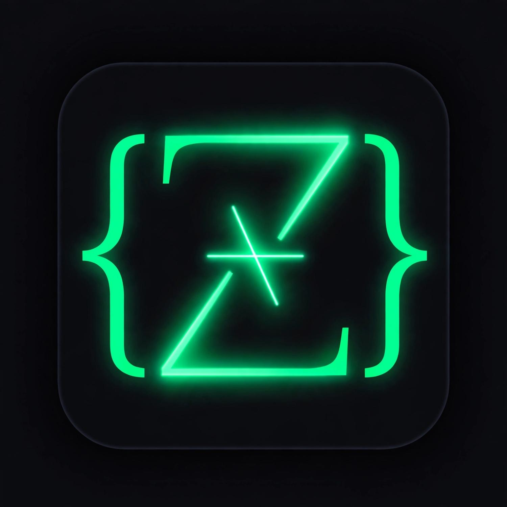

# Zeno Editor

**AI-Powered Code Editor** — Spck Code Editor clone with full-screen AI Vision Extension.

Built with **Ionic Angular + Capacitor 6 + Monaco Editor**.



## Features

- Monaco Editor (same engine as VS Code) — syntax highlighting for HTML, CSS, JS, TS, Python, JSON
- File Explorer (create / delete / rename) with persistent storage in `Documents/ZenoProjects/`
- Multi-tab editing
- Live HTML/CSS/JS Preview (iframe)
- Bottom Terminal (JS eval + Python via Pyodide)
- Auto-save + Ctrl+S
- **Zeno AI Vision Extension**
  - Offline Layer 1: bracket / colon auto-fix + Monaco markers
  - Online Layer 2: OpenAI-compatible API (key in Settings)
  - Sees entire project, open tabs, errors, terminal
  - Auto Debug Mode (1.5s debounce)
  - Diff + Apply Fix

## GitHub Actions — Automatic APK Build

Every push to `main` triggers a workflow that:

1. Installs Node + Java + Android SDK
2. Builds the web app
3. Adds / syncs Capacitor Android
4. Builds a **debug APK**
5. Uploads it as a workflow artifact + creates a GitHub Release

### How to download the APK

1. Go to **Actions** tab → latest successful run
2. Download artifact **`zeno-editor-apk`**
3. Or go to **Releases** and download `app-debug.apk`

You can also manually trigger the workflow: **Actions → Build Android APK → Run workflow**

## Local Development

```bash
npm install --legacy-peer-deps
npm start
# open http://localhost:4200
```

Web mode uses localStorage as filesystem fallback.

## Build APK Locally

```bash
npm install --legacy-peer-deps
npm run build
npx cap add android   # first time only
npx cap sync android
npx cap open android
# Then in Android Studio: Build → Build APK(s)
```

## AI Setup

1. Tap the gear icon
2. Paste an OpenAI-compatible API key (OpenAI, Groq, Together, DeepSeek, Ollama proxy...)
3. Optionally change the endpoint
4. Enable **Auto Debug** with the bug icon in the AI panel

## Project Structure

```
src/app/
  pages/editor/          # Main editor (Monaco + UI)
  services/
    filesystem.service.ts  # Capacitor Filesystem CRUD
    ai-vision.service.ts   # Offline linter + Online AI
capacitor.config.ts
android/                   # Native Android project (generated/synced by Cap)
.github/workflows/build-apk.yml  # Automatic APK builds
```

## License

MIT
